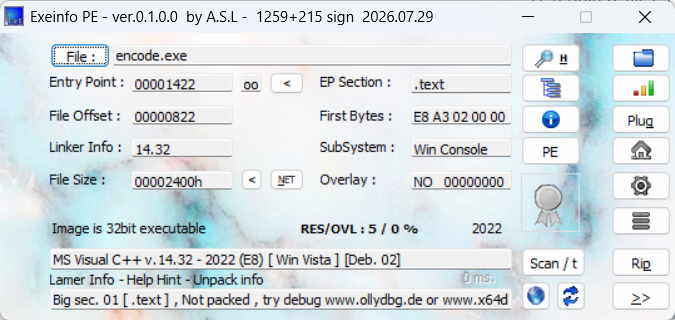
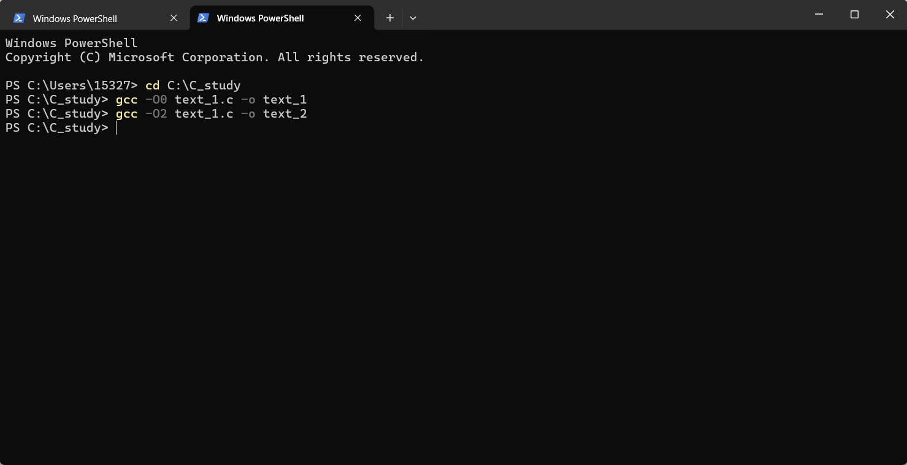
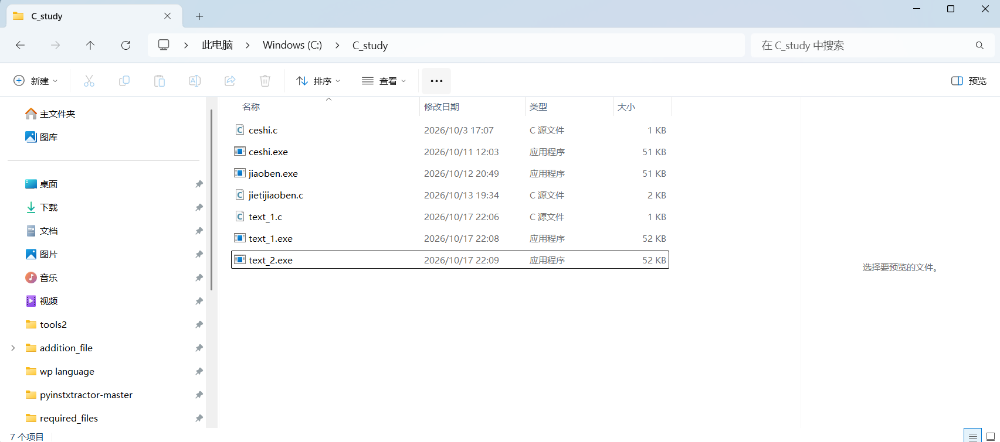
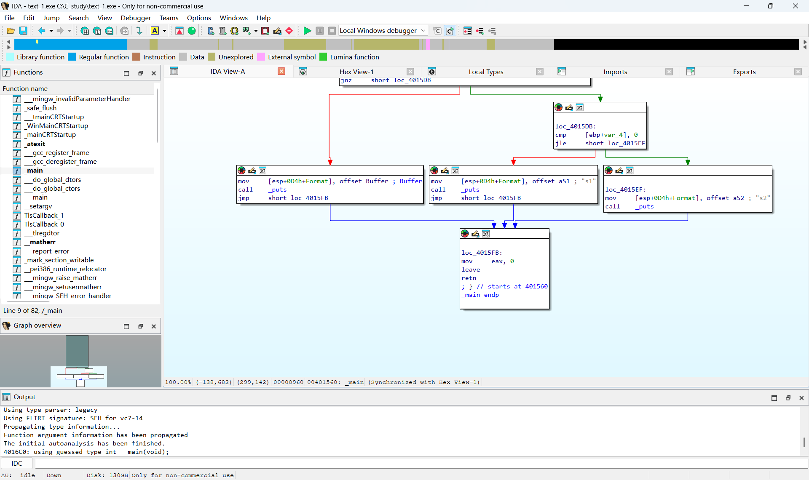
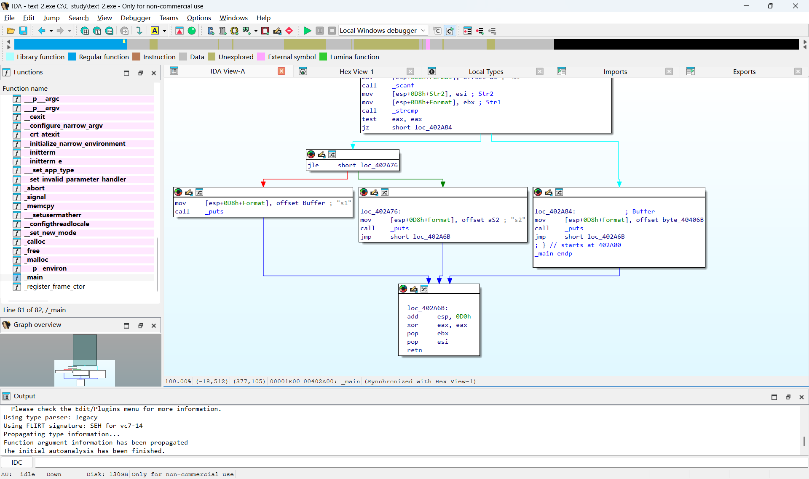
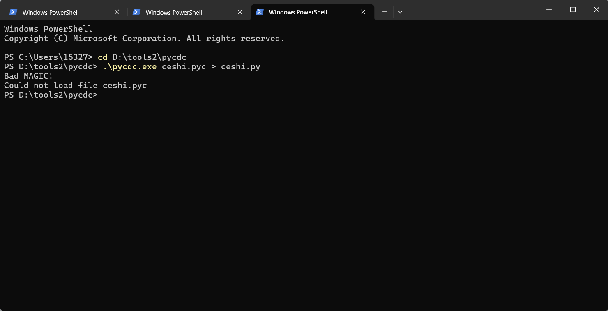
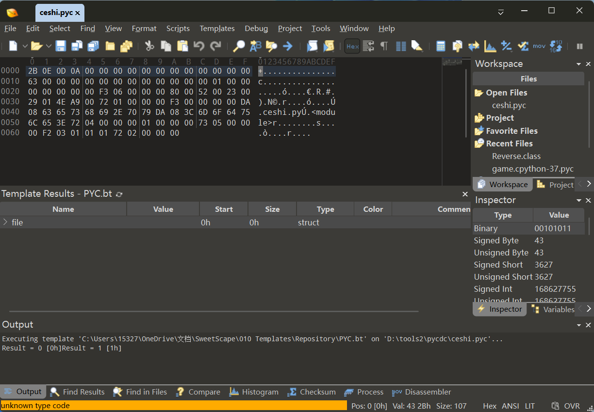
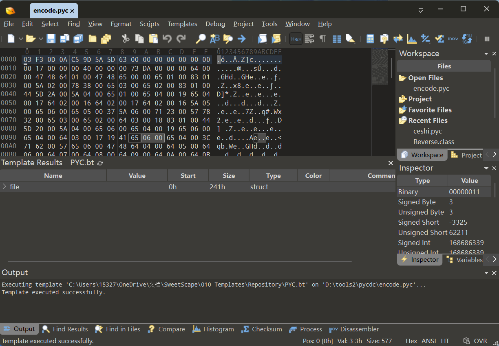
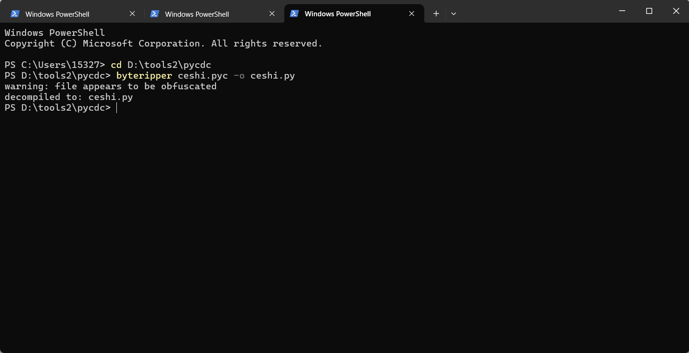
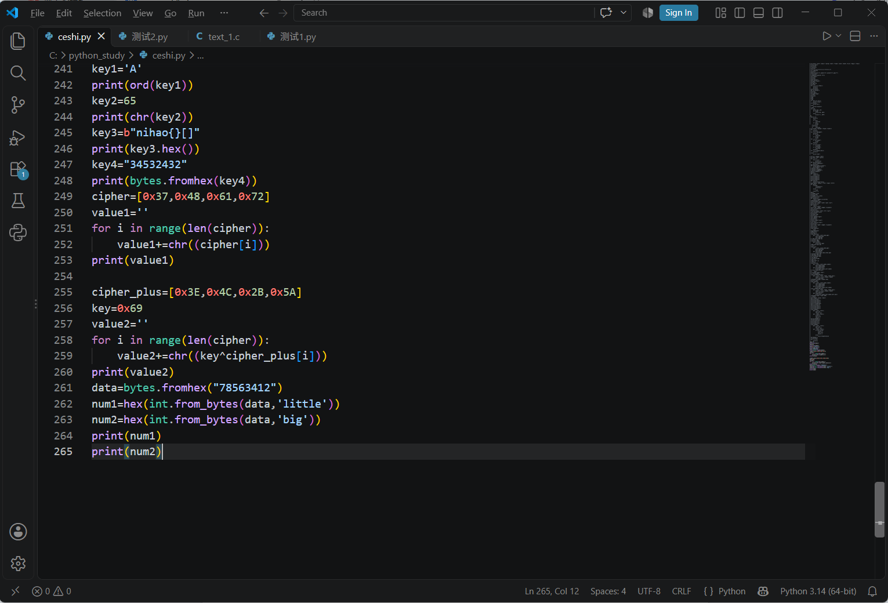

作为初学者，首先我需要学习一些相关的专业术语，安装一些应用程序

## 基础专业术语
机器码是直接运行的二进制指令，比如.exe，.elf，.dll文件，由CPU直接执行，依赖CPU本身的架构，机器码通常使用十六进制表示。  
例子55 48 89 E5 为x64汇编机器码
字节码是由VM虚拟机，解释器的代码，比如.pyc文件，.class文件，依赖解释器的版本,和CPU没有任何关系。  
不同平台的虚拟机(JVM,Python)会把字节码编译为对应平台的机器码，因此同一字节码可以在不同平台运行  
汇编码是机器码的文本形式，在文件为可执行文件.exe时才会出现汇编码  
push pop jmp 等均为汇编码例子
汇编器是把汇编码编译为机器码，而反汇编是把机器码还原为汇编码  
壳是机器码的代码，如果代码被加了壳，运行时会先运行壳代码，解密原来的程序，再跳转到原始程序的执行入口，最后执行原来的程序  
加壳是把壳代码写入.exe文件的PE节表，修改PE的入口点，使得系统加载代码时先跳转到壳代码，加壳本身不会改变原始程序的执行入口，壳代码执行完再跳转到原来程序的入口点  
而查壳工具通过识别壳代码的机器码(不同的壳，机器码，PE节表都不一样)  
魔数是指文件开头的4个字节，这四个字节决定了文件的类型(或者说后缀)，对于不同版本的python文件，魔数也是不一样的

以Exeinfo PE为例子  
Entry point是程序的入口点，First Bytes是首字节机器码(EB A3 02 00 00)，SubSystem是控制台程序，此处是命令行,32bit是32位程序，下边一行是编译器，Not packed是没有加壳(可以直接进行调试)
## IDA的使用
下载好minggw(gcc)编译器后，尝试使用不同的汇编命令对同一个C程序进行编译，分别使用IDA打开观察main函数  
C代码写了一个简单的比较字符串  
#include <stdio.h>  
#include <string.h>  
int main(void)  
{  
​    char s1[100],s2[100];  
​    int ret;  
​    printf("输入字符串1:");  
​    scanf("%s", s1);  
​    printf("输入字符串2:");  
​    scanf("%s", s2);  
​    ret=strcmp(s1, s2);  
​    if(ret==0)  
​        printf("相等\n");  
​    else if(ret > 0)  
​        printf("s1更大\n");  
​    else  
​        printf("s2更大\n");  
​    return 0;  
}  
使用不同的汇编指令
`gcc -O0 text_1.c -o text_1`  -o0是没有开启优化  
`gcc -O2 text_1.c -o text_2`  -o2是开启了优化

先打开text_1.exe,发现main汇编长度是000000A2，转化为十进制是162  
伪代码
int __cdecl main(int argc, const char **argv, const char **envp)  
{  
  char Str2[100]; // [esp+8h][ebp-CCh] BYREF  
  char Str1[100]; // [esp+6Ch][ebp-68h] BYREF  
  int v6; // [esp+D0h][ebp-4h]  
  __main();  
  printf(Format: &Format);  
  scanf(Format: "%s", Str1);  
  printf(Format: &byte_404059);  
  scanf(Format: "%s", Str2);  
  v6 = strcmp(Str1, Str2);  
  if ( v6 != 0 )  
  {  
​    if ( v6 <= 0 )  
​      puts(Buffer: aS2);  
​    else  
​      puts(Buffer: aS1);  
  }  
  else  
  {  
​    puts(Buffer: &Buffer);  
  }  
  return 0;  
}  
再打开text_2.exe,发现main汇编长度是00000092，转化为十进制是146，main主函数字节长度比前一个文件小16
伪代码  
int __cdecl main(int argc, const char **argv, const char **envp)  
{  
  int v3; // eax  
  char Str1[100]; // [esp+8h][ebp-D0h] BYREF  
  char Str2[108]; // [esp+6Ch][ebp-6Ch] BYREF  
  __main();  
  printf(Format: &byte_404044);  
  scanf(Format: "%s", Str1);  
  printf(Format: &byte_404059);  
  scanf(Format: "%s", Str2);  
  v3 = strcmp(Str1, Str2);  
  if ( v3 != 0 )
  {
​    if ( v3 <= 0 )
​      puts(Buffer: aS2);
​    else
​      puts(Buffer: Buffer);
  }
  else
  {
​    puts(Buffer: &byte_40406B);
  }
  return 0;
}
二者的伪代码几乎没有区别，main汇编的控制流图也差别不大。

## 加包与解包
尝试对.py文件执行打包和解包处理，使用pyinstaller进行打包，使用pyinstxtractor进行解包，使用pycdc进行反编译
`cd C:\python_study` 切到目标文件目录  
`pyinstaller -F ceshi.py` 执行打包(这里的-F其实是--onefile单文件模式，一开始并没有想单文件模式是什么意思)  
`cd D:\tools2\pyinstxtractor-master` 切到解包工具的目录  
`python pyinstxtractor.py ceshi.exe` 执行解包  
解包会出现一个文件夹，名字是文件名加_extracted，在文件夹里找到ceshi.pyc文件  
`.\pycdc.exe ceshi.pyc > ceshi.py` 执行反编译，此时命令行显示了Bad Magic 魔数错误。  
才知道加包python版本是3.14，而pycdc不支持该版本，在读取文件魔数时会直接报错，文件反编译失败。

前一个文件前4个字节是 2B 0E 0D 0A 前两位不是Python pyc魔数，而是Pycodeobject的标记  
后一个文件前4个字节是03 F3 0D 0A，是正常的Python 3.14 pyc魔数。  
换一个反编译工具继续试

`byteripper ceshi.pyc -o ceshi.py`使用byteripper进行反编译，又出现报错，目标.py文件只有三行有关反编译工具的信息，没有代码，警告说文件经过混淆处理 
查资料发现是参数的问题，-F是--onefile单文件模式，仅仅交付一个.exe，pyinstaller在打包时会丢弃.pyc文件头(魔数)，程序只有字节码，这样解码后的.pyc文件并没有.pyc文件应有的文件头(魔数)。  
而不加任何参数,即--onedir是交付整个文件夹，不会丢弃.pyc文件头  
按照不加参数重新尝试了一遍，反编译成功了，整个加包和解包的操作就完成了
## 代码学习
简单学习一下数据转换  
ord 字符转ASCII  
chr  ASCII转字符  
hex  字节转十六进制  
byte 十六进制转字节  
简单的数组转字符串，异或运算，大端序，小端序  
测试代码

多字节循环key的意思是如果密钥的长度小于明文的长度，使用取模运算控制密钥的下标不断循环，即重复使用密钥字节执行加密/解密。  
把函数拆开来写  
def xor_cycle(data, key):  
​    value = b""  
​    changdu = len(key)  
​    for i, j in enumerate(data):  
​        key_index = i % changdu  
​        k_byte = key[key_index]  
​        value += bytes([j ^ k_byte])  
​    return value
